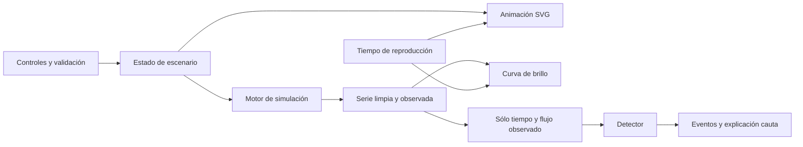

# Arquitectura propuesta

Aplicación estática React + TypeScript estricto + Vite. SVG nativo para estrella, planeta y curva; CSS para disposición adaptable. Npm con lockfile; versiones exactas compatibles fijadas en T000 tras revisar documentación vigente. Vitest para unidades y Playwright para recorridos de navegador. No instalar bibliotecas gráficas o de estado adicionales sin justificar una necesidad concreta.

## Límites entre módulos

- `src/contracts/`: tipos y límites compartidos; propietario productor.
- `src/simulation/`: funciones puras de validación científica, posición, ocultación y ruido; A1.
- `src/components/`, `src/app/`, `src/styles/`: controles, vistas y estado de reproducción; A2.
- `src/analysis/`: detector independiente de la simulación; A3.
- `tests/simulation/`, `tests/ui/`, `tests/analysis/`: pruebas del propietario del módulo.
- `tests/e2e/`, `tests/fixtures/`: aceptación y datos independientes; A3, sin cambiar otras áreas sin asignación.
- Raíz, `src/main.tsx`, configuración npm/Vite/TS/lint, `index.html`, `src/contracts/`, `.github/` y documentación común: productor o tarea expresamente delegada.

Estas carpetas de código se crearán en implementación, no contienen código en esta entrega documental. El propietario no es un bloqueo absoluto: una tarea puede autorizar un cambio concreto en otro módulo, con revisión y coordinación previas.

## Estado y sincronización

El escenario es la única fuente de parámetros. Generar la serie sólo al confirmar cambios físicos o de ruido; `requestAnimationFrame` avanza el tiempo y consulta las mismas ecuaciones de posición. La animación y el marcador de la curva comparten un tiempo en días. No se regenera ruido por cuadro. Pausa conserva datos y tiempo; reiniciar vuelve a t=0 con la misma semilla. Cambiar parámetros invalida cualquier detección anterior y reinicia tiempo y serie. Sólo el botón de nueva realización cambia la semilla.

La curva conserva las 5001 muestras para análisis; si se reduce el dibujo, se preservan mínimos por bloque y el detector recibe siempre la serie completa. Cálculo y dibujo se miden antes de añadir Web Workers o Canvas. La vista representa la proyección aparente; si la órbita no cabe, una vista esquemática secundaria debe rotularse como tal.

## Entrega sin servidor propio

Un build genera `dist/`. GitHub Pages distribuye ese contenido por HTTPS. Cada visitante ejecuta los cálculos en su navegador y su estado no se comparte. No hay necesidad de base de datos ni backend para unas diez personas que prueban escenarios separados. No se prometen sesiones sincronizadas.

Configurar `base: '/AstroDetect/'` y una sola página sin rutas profundas. El dominio previsto es https://tbl4z3r.github.io/AstroDetect/; no es una página actualmente publicada. Probar los recursos desde esa subruta. La configuración y el workflow se construyen en T000/T403, no se presumen existentes.
